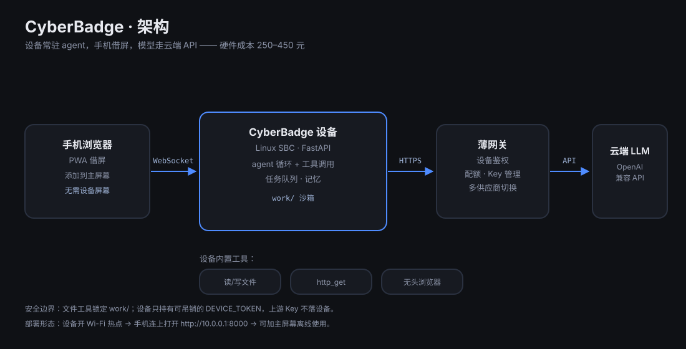

# CyberBadge · A pocket host for your personal AI agent

**English** | [简体中文](README.md)

[](https://github.com/yzf5729/cyberbadge/actions/workflows/ci.yml)
[](LICENSE)
[](https://www.python.org/)


Turn a cheap Linux board into an **always-on host for an AI agent**: the device runs tasks, manages files and drives a headless browser. No screen required — your phone becomes the display (Borrow-Screen). Models run through cloud APIs, with keys kept behind a thin gateway.

> Target form factor: a badge-sized wearable. It also runs on any small Linux box or Raspberry Pi today.

> Status: v0.1 runnable demo (software). Hardware BOM in [`docs/bom.md`](docs/bom.md).



## Why

- Voice-first hardware (ESP32-class) can chat, but can't run agent tasks.
- Desktop agents (Open Interpreter, etc.) are neither portable nor always-on.
- Mobile OSes kill background agents and restrict permissions.

**CyberBadge = always-on agent + file/browser tools + borrowed screen.** Hardware cost: ¥250–450 (~US$35–65).

## Quick start (no hardware needed)

```bash
git clone <this-repo> && cd cyberbadge
python3 -m venv .venv && . .venv/bin/activate
pip install -r requirements.txt
cp .env.example .env        # set LLM_API_KEY (any OpenAI-compatible API)
uvicorn device.main:app --host 0.0.0.0 --port 8000
```

- Desktop browser: `http://localhost:8000`
- Phone on the same Wi-Fi: `http://<device-ip>:8000` → "Add to Home Screen" to install as a PWA

Runs without an API key as well — it enters demo mode and returns a sample reply.

Want actual hardware with a touchscreen? See [`docs/m0-build.md`](docs/m0-build.md) (M0 prototype: mains power + Wi-Fi + 5" touchscreen, ~US$65).

## Product definition

A **pocket butler for all your personal devices**: an always-on AI agent that carries your identity and permissions and orchestrates PCs, NAS, routers and gateways at home, in the office and in the cloud.

See [`docs/product-definition.en.md`](docs/product-definition.en.md).

## Three form factors

- **M1 Standalone**: built-in touchscreen + 4G, works without a phone.
- **M2 Online**: screenless + 4G, phone as display, the agent never goes offline.
- **M3 Lite**: screenless, no cellular; borrows the phone's hotspot. Lightest and cheapest.

See [`docs/modes.en.md`](docs/modes.en.md).

## Capabilities

| Capability | Notes |
|---|---|
| Chat | Streaming or single reply, with tool calls |
| Files | Read/write/list inside the `work/` sandbox |
| Web | `http_get` fetch; headless browser if Playwright is installed |
| Tasks | `POST /api/task` for background jobs, results persisted to disk |
| Borrow-screen | PWA on the phone, no device screen required |

## Repository layout

```
device/    Linux daemon (FastAPI + agent loop + tools)
web/       PWA frontend (works in any phone browser)
gateway/   Thin gateway: device auth, quotas, key management, provider fallback
docs/      Architecture, related work, BOM, roadmap
scripts/   One-command dev runner
```

## Roadmap

- v0.1 software demo (current): chat + files + web fetch + PWA
- v0.2 voice: VAD + streaming cloud ASR/TTS, push-to-talk
- v0.3 hardware: Orange Pi Zero 3 + 4G + battery, image script and enclosure
- v0.4 gateway: quotas, multi-provider routing, device registration

## License

MIT
---

© 2026 Z.Yang · [MIT License](LICENSE)
