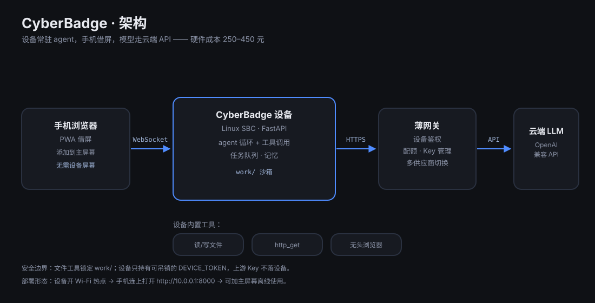

# CyberBadge · 赛博胸牌

[English](README.en.md) | **简体中文**

[](https://github.com/yzf5729/cyberbadge/actions/workflows/ci.yml)
[](LICENSE)
[](https://www.python.org/)


把一台几百块的 Linux 小机器变成**常驻的 AI agent 宿主**：设备负责跑任务、管文件、控浏览器；屏幕可以不要，用手机浏览器当显示器（Borrow-Screen）；模型走云端 API，密钥由薄网关托管。

> 中文名 **赛博胸牌**：目标形态是胸牌大小的随身设备，也可以先跑在任意 Linux 小主机或树莓派上。

> 状态：v0.1 可运行 demo（软件部分）。硬件 BOM 与装配说明见 `docs/bom.md`。



## 为什么做这个

- 语音硬件（ESP32 那类）只能对话，跑不了 agent 任务；
- 电脑上的 agent（Open Interpreter 等）不能随身、不能 7×24；
- 手机 OS 会杀后台、权限受限。

**CyberBadge = 常驻 agent + 文件/浏览器工具 + 借屏交互**，硬件成本 250–450 元。

## 快速开始（零硬件，用你的电脑/树莓派）

```bash
git clone <this-repo> && cd cyberbadge
python3 -m venv .venv && . .venv/bin/activate
pip install -r requirements.txt
# 可选：文档 / OCR / 图像能力（见 docs/capabilities.md）
pip install -r requirements-tools.txt
cp .env.example .env        # 填 LLM_API_KEY（任何 OpenAI 兼容接口）
uvicorn device.main:app --host 0.0.0.0 --port 8000
```

- 电脑浏览器打开 `http://localhost:8000`
- 手机与设备同一 Wi-Fi，打开 `http://<设备IP>:8000`，可"添加到主屏幕"当 PWA

没有 API key 也能启动：会进入演示模式，并产生一条示例任务。

想做**实物验证**？见 [`docs/m0-build.md`](docs/m0-build.md)；想了解**先开发后移植**的策略，见 [`docs/portability.md`](docs/portability.md)；**决策记录**见 [`docs/decisions.md`](docs/decisions.md)、**项目规则**见 [`AGENTS.md`](AGENTS.md)（M0 验证机：8G 无屏 + Wi-Fi + 充电宝，约 440–530 元，手机当屏）。

## 产品定义

**随身携带的个人设备大管家**：常驻 AI agent 带着你的身份与权限，随时调度家里、办公室和云上的电脑、NAS、路由器与网关。

详见 [`docs/product-definition.md`](docs/product-definition.md)。

## 三种形态（另有 M0 验证机）

- **M1 独立版**：自带触摸屏 + 4G，脱离手机独立工作；
- **M2 在线版**：无屏 + 4G，手机借屏，agent 永不掉线；
- **M3 轻量版**：无屏无 4G，借手机热点，最轻最省。

详见 [`docs/modes.md`](docs/modes.md)。

## 它能做什么

| 能力 | 说明 |
|---|---|
| 对话 | 流式/整段聊天，支持工具调用 |
| 文件 | 读写、列目录（限定在 `work/` 沙箱内） |
| 网页 | `http_get` 抓取；装了 Playwright 可无头浏览器 |
| 定时任务 | `/api/task` 投递任务，后台执行，结果落盘 |
| 借屏 | PWA（手机浏览器），无需设备屏幕 |

## 仓库结构

```
device/    Linux 端守护进程（FastAPI + agent 循环 + 工具）
web/       PWA 前端（手机浏览器即用）
gateway/   薄网关：设备鉴权、配额、Key 管理、多供应商 fallback
docs/      架构、相关项目、BOM、路线图
scripts/   一键启动脚本
```

## 路线图

- v0.1 软件 demo（当前）：对话 + 文件 + 网页抓取 + PWA
- v0.2 语音：VAD + 云端流式 ASR/TTS，按住说话
- v0.3 硬件：Orange Pi Zero 3 + 4G + 电池，镜像脚本与外壳
- v0.4 网关：配额计费、多供应商切换、设备注册

## 许可

MIT
---

© 2026 Z.Yang · [MIT License](LICENSE)
